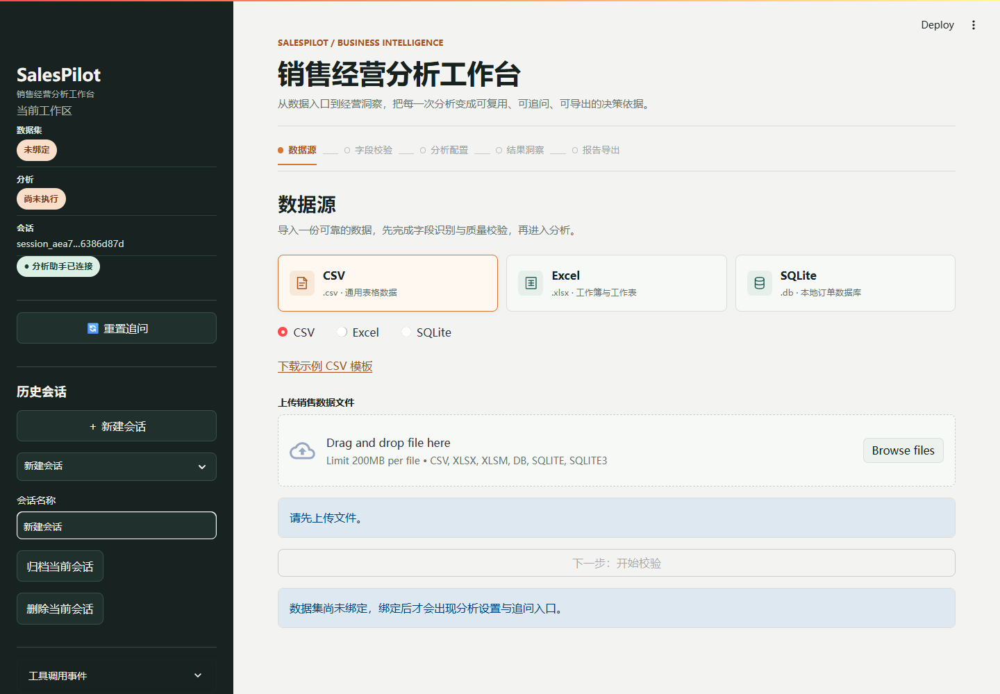

# SalesPilot

**Languages:** English | [简体中文](README_zh-CN.md)

**An AI-assisted sales analytics workbench that turns CSV, Excel, and SQLite data into traceable metrics, business insights, and downloadable reports.**

[](https://www.python.org/)
[](https://streamlit.io/)
[](LICENSE)

[GitHub](https://github.com/jmm053016-cpu/SalesPilot) · [Gitee mirror](https://gitee.com/gold-m/sales-pilot)

SalesPilot automates the path from data import to analysis. With DeepSeek configured, its agent can inspect a source, map fields, validate and save a dataset, and run the requested analysis without a separate manual analysis step. A deterministic Python engine computes every metric; the model explains the returned evidence and supports follow-up discussion, but never invents numeric results. Reports are available as Word or PDF.

## Interface Preview



The preview shows the current data-source workbench, including persistent conversation history and CSV, Excel, and SQLite import options. After import, the agent can validate the data and start the analysis workflow; results and reports remain available in the conversation.

## Features

- Import CSV and Excel files, or connect to a supported SQLite data source.
- Let the agent inspect source columns, propose field mappings, validate the data, save the dataset, and launch analysis.
- Preserve source amount precision with decimal arithmetic instead of rounding imported values to two decimal places.
- Calculate sales, net sales, gross profit, order counts, period comparisons, rankings, and anomalies when the required source fields are available.
- Keep unavailable metrics explicit instead of estimating missing values.
- Export reports and supporting charts as Word or PDF.
- Persist conversations and their dataset, analysis, and report bindings in local SQLite storage; archived conversations are read-only and can be restored.
- Discuss saved analysis results with the DeepSeek-powered assistant; optional Tavily search can add external market context.
- Restrict the assistant to dataset inspection, controlled analysis requests, and report export; it does not accept arbitrary SQL, Python, file paths, or user code.

## Requirements

- Python 3.12
- An LLM API key is optional. Deterministic analysis and report generation work without one; model-based narrative and follow-up features require a configured provider.

## Quick Start

Clone either repository:

```bash
git clone https://github.com/jmm053016-cpu/SalesPilot.git
cd SalesPilot
```

For the Gitee mirror, use:

```bash
git clone https://gitee.com/gold-m/sales-pilot.git
cd sales-pilot
```

Create and activate a virtual environment, then install the dependencies:

```bash
python -m venv .venv
```

Windows PowerShell:

```powershell
.\.venv\Scripts\Activate.ps1
```

macOS or Linux:

```bash
source .venv/bin/activate
```

Install and run:

```bash
python -m pip install -r requirements.txt
streamlit run app.py
```

Open the local URL printed by Streamlit, usually `http://localhost:8501`.

## Configuration

Copy `.env.example` to `.env` and add the credentials for the provider you want to use. Keep `.env` private; it is excluded by `.gitignore`.

| Variable | Purpose |
| --- | --- |
| `DEEPSEEK_API_KEY` | Enables agent-managed import and analysis, report narratives, and follow-up conversations. |
| `DEEPSEEK_MODEL` | DeepSeek model name; defaults to `deepseek-flash`. |
| `DEEPSEEK_BASE_URL` | DeepSeek-compatible API endpoint; defaults to `https://api.deepseek.com`. |
| `TAVILY_API_KEY` | Optional web search for external market and industry context. |

Without DeepSeek credentials, deterministic analysis and report generation remain available, but agent-managed workflows and model-assisted discussion are disabled. Tavily is optional and only adds web search; search results do not participate in sales metric calculations.

## Data and Analysis

The import workflow previews source data, maps recognized column aliases, validates the selected data grain, and reports which metrics are available. CSV and Excel uploads are supported. SQLite access is restricted to the application's supported read-only source query.

Required fields include a parseable order date and a non-negative sales amount. Optional fields such as refunds, cost, order ID, quantity, product, category, region, and currency enable additional metrics and breakdowns. Mixed-currency datasets are rejected; currency conversion is not performed.

Analysis is deterministic and uses decimal arithmetic for monetary calculations. For example, net sales require refund information or an explicit confirmation that there were no refunds; order counts require order-level detail and order IDs; gross profit requires cost data. Missing inputs are reported as unavailable rather than inferred.

Runtime datasets, analyses, conversations, reports, and uploads are stored under `.runtime/` and excluded from version control. Conversation records and messages are persisted in SQLite so they survive application restarts. Resources remain scoped to their original session; archived conversations can be viewed and unarchived.

## Tests

Run the deterministic test suite:

```bash
python -m pytest -q
```

The suite covers data import and validation, analysis metrics, rankings and comparisons, agent boundaries, session and conversation behavior, and report generation.

Tests use local fixtures and do not require live model API calls. Configuring an API key may cause real usage charges when you run the application with model-assisted features.

## Project Layout

```text
app.py              Streamlit application entry point
agent/              Agent runtime, prompts, and controlled analysis tools
analytics/          Deterministic metrics, comparisons, rankings, and anomaly analysis
charts/             Sales chart generation
data_sources/       CSV, Excel, and SQLite import, mapping, and validation
models/             Data, analysis, report, and conversation models
reports/            Word/PDF report generation and artifact verification
storage/            Session-scoped dataset, analysis, conversation, and artifact storage
ui/                 Data entry, analysis workspace, results, and follow-up interface
workflow/           Analysis-to-report workflow
tests/              Unit and workflow tests with sample fixtures
```

## License

SalesPilot is distributed under the [MIT License](LICENSE).
